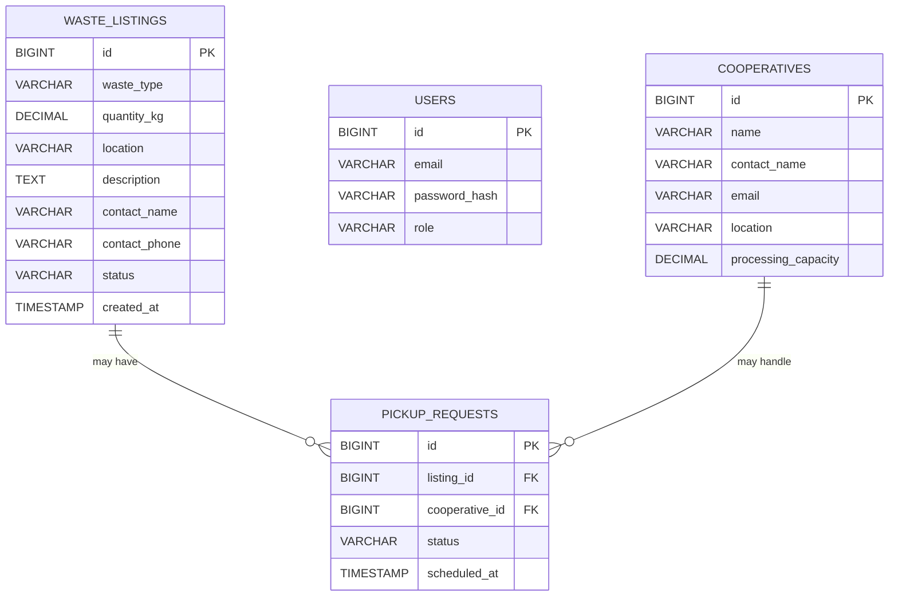

# EcoConnect — Database Design

## 1. Overview

EcoConnect uses MySQL as its relational database to store and manage application data. The backend is developed using Java Spring Boot, Spring Data JPA, and Hibernate.

The database supports the platform's primary objective: connecting urban organic-waste generators with rural women-led cooperatives.

The current implementation includes a `waste_listings` table for storing waste listing information. Additional tables may be introduced as authentication, cooperative registration, pickup scheduling, and impact tracking are implemented.

## 2. Database Information

| Property | Details |
|---|---|
| Database name | `ecoconnect_db` |
| Database type | MySQL |
| Backend framework | Spring Boot |
| ORM | Hibernate |
| Data access | Spring Data JPA |
| Current main table | `waste_listings` |

## 3. Current Database Schema

### 3.1 Waste Listings Table

The `waste_listings` table stores information submitted by users who want to make organic waste available for collection.

| Column | Data type | Description |
|---|---|---|
| `id` | BIGINT | Primary key; uniquely identifies each listing |
| `waste_type` | VARCHAR | Type of organic waste |
| `quantity_kg` | DECIMAL | Quantity of waste in kilograms |
| `location` | VARCHAR | Pickup location |
| `description` | TEXT or VARCHAR | Additional details or handling instructions |
| `contact_name` | VARCHAR | Name of the contact person |
| `contact_phone` | VARCHAR | Contact phone number |
| `status` | VARCHAR | Current listing status; defaults to `AVAILABLE` |
| `created_at` | DATETIME/TIMESTAMP | Date and time when the listing was created |

**Note:** Exact column types and constraints should be verified against the actual MySQL table definition. Hibernate entity mappings and the existing database schema determine the final physical structure.

### 3.2 Primary Key

The `id` column uniquely identifies each waste listing. It allows individual records to be retrieved and referenced without relying on waste type or location.

### 3.3 Listing Status

The `status` field represents the current state of a waste listing.

The initial status is `AVAILABLE`. As collection functionality is developed, additional statuses may be introduced, such as:

- `MATCHED`
- `ACCEPTED`
- `PICKUP_SCHEDULED`
- `COLLECTED`
- `CANCELLED`

These additional values represent proposed workflow states and should be implemented consistently in the backend.

## 4. Entity Relationship Overview

The following diagram illustrates the current entity and potential future relationships.



**Diagram note:** `WASTE_LISTINGS` reflects the current implemented table. `USERS`, `COOPERATIVES`, and `PICKUP_REQUESTS` are proposed entities for future development; their presence in this diagram does not mean those tables already exist in MySQL. The `PICKUP_REQUESTS` relationships are planned.

## 5. Proposed Future Tables

### 5.1 Users

A `users` table can support persistent user accounts and role-based access.

Proposed fields:

| Column | Purpose |
|---|---|
| `id` | Unique user identifier |
| `email` | User's login email |
| `password_hash` | Securely hashed password |
| `role` | `URBAN_USER`, `COOPERATIVE_COORDINATOR`, or `ADMIN` |
| `created_at` | Account creation timestamp |

Passwords must never be stored as plain text. Authentication should be implemented and validated by the Spring Boot backend.

### 5.2 Cooperatives

A `cooperatives` table can store information about participating rural women-led cooperatives.

Proposed fields:

| Column | Purpose |
|---|---|
| `id` | Unique cooperative identifier |
| `name` | Cooperative name |
| `contact_name` | Contact person's name |
| `email` | Cooperative contact email |
| `location` | Cooperative location |
| `processing_capacity` | Maximum processing capacity |
| `created_at` | Registration timestamp |

The exact data types and relationships should be finalized when cooperative registration is connected to persistent backend storage.

### 5.3 Pickup Requests

A `pickup_requests` table can support coordination between waste generators and cooperatives.

Proposed fields:

| Column | Purpose |
|---|---|
| `id` | Unique pickup request identifier |
| `listing_id` | Reference to a waste listing |
| `cooperative_id` | Reference to a cooperative |
| `status` | Current pickup request status |
| `scheduled_at` | Planned pickup date and time |
| `created_at` | Request creation timestamp |

Foreign keys should enforce valid references to the corresponding records.

## 6. Database Operations

### 6.1 View Existing Listings

```sql
USE ecoconnect_db;

SELECT *
FROM waste_listings;
```

### 6.2 View the Newest Listings First

```sql
SELECT *
FROM ecoconnect_db.waste_listings
ORDER BY created_at DESC;
```

### 6.3 Count Listings by Status

```sql
SELECT status, COUNT(*) AS total_listings
FROM ecoconnect_db.waste_listings
GROUP BY status;
```

### 6.4 Calculate Total Waste Listed

```sql
SELECT SUM(quantity_kg) AS total_waste_kg
FROM ecoconnect_db.waste_listings;
```

### 6.5 Inspect the Table Structure

```sql
DESCRIBE ecoconnect_db.waste_listings;
```

This query can be used to verify the actual column names, types, and nullability in MySQL Workbench.

## 7. Backend Integration

The React frontend communicates with the Spring Boot backend through REST API endpoints.

The currently implemented waste-listing endpoints are:

| Method | Endpoint | Purpose |
|---|---|---|
| `POST` | `/api/waste-listings` | Create and save a waste listing |
| `GET` | `/api/waste-listings` | Retrieve saved waste listings |

The backend uses Spring Data JPA repositories to persist and retrieve entities. Hibernate generates the relevant SQL operations, while MySQL stores the records.

The frontend should display a success message only after the backend confirms that a listing has been saved successfully.

## 8. Data Integrity and Security

The following practices should be followed as development progresses:

- Use primary keys to identify records uniquely.
- Validate required fields and quantities before saving records.
- Use suitable numeric types for waste quantities and processing capacities.
- Apply appropriate `NOT NULL` constraints to mandatory fields.
- Use foreign keys for relationships between listings, cooperatives, and pickup requests.
- Store phone numbers as strings to preserve formatting and leading zeros.
- Store passwords as secure hashes rather than plain text.
- Keep database credentials in environment variables or other secure configuration.
- Avoid committing passwords, tokens, or other secrets to GitHub.
- Use database transactions where multiple related records must be updated consistently.

## 9. Future Enhancements

The database can be extended to support:

- Persistent user accounts and authentication.
- Cooperative registration and profile management.
- Waste listing ownership.
- Cooperative-to-listing matching.
- Pickup scheduling and collection status tracking.
- Environmental impact measurements.
- Administrative reporting and analytics.

Any new table or relationship should be reflected in the Spring Boot entity mappings and validated against the MySQL schema.

## 10. Conclusion

The current EcoConnect database provides persistent storage for waste listings through MySQL and the Spring Boot backend. The proposed future schema outlines how the platform can expand to support user accounts, cooperative management, pickup coordination, and environmental impact reporting.

The database design should evolve alongside the implemented application features, maintaining data integrity, security, and clear relationships between records.
