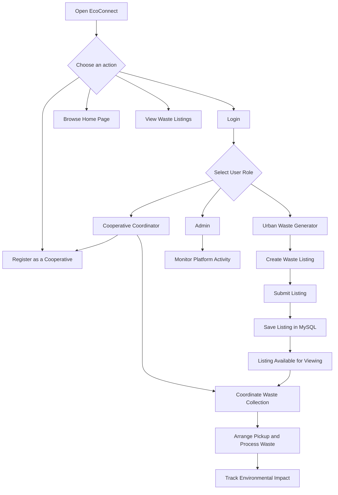
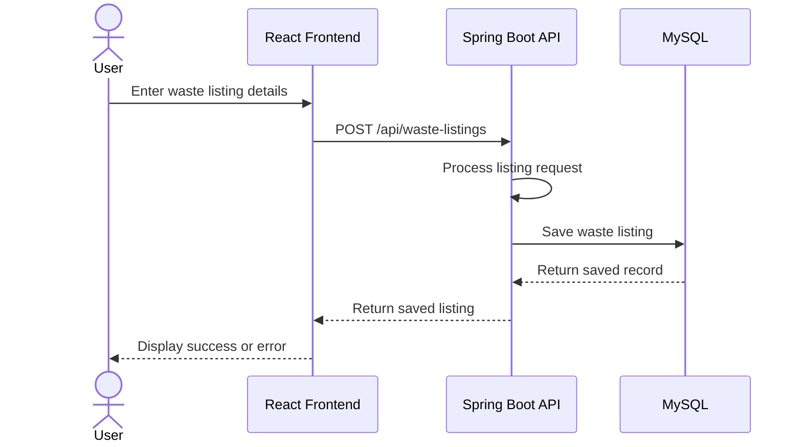

# EcoConnect — User Flow

## 1. Overview

EcoConnect is a web-based platform that connects urban organic-waste generators with rural women-led cooperatives. It helps coordinate waste listings, collection requests, cooperative participation, and environmental impact tracking.

The platform has three primary user roles:

1. **Urban Waste Generator**
2. **Cooperative Coordinator**
3. **Admin**

## 2. User Roles and Responsibilities

### 2.1 Urban Waste Generator

Urban users, such as households, restaurants, and other waste-generating organizations, can use EcoConnect to:

- Access the platform.
- Create a listing for available organic waste.
- Provide the waste type, quantity, pickup location, and additional details.
- View available waste listings.
- View listing details and pickup information.
- Track the progress of waste collection as the relevant functionality becomes available.

### 2.2 Cooperative Coordinator

Cooperative coordinators represent rural women-led cooperatives that collect and process organic waste.

Their intended responsibilities include:

- Access the platform as a cooperative coordinator.
- Register a cooperative and provide its contact details, location, and processing capacity.
- View available waste listings.
- Coordinate waste collection and pickup requests.
- Manage cooperative processing capacity.
- Track collection activities and processing outcomes.

### 2.3 Admin

The admin oversees the platform and its operations.

The intended responsibilities include:

- Access the platform as an administrator.
- Monitor waste listings and collection activity.
- Review cooperative participation.
- Monitor platform performance.
- Track environmental and operational impact.

## 3. Main User Flow

*Note: The diagram represents the intended end-to-end workflow. Some steps, such as role-specific authorization, cooperative matching, pickup scheduling, and impact tracking, require further implementation.*

## 4. Urban Waste Generator Flow

1. The user opens the EcoConnect website.
2. The user navigates to the Waste Listings section.
3. The user selects **New Listing**.
4. The user enters the following information:
   - Waste type
   - Quantity in kilograms
   - Pickup location
   - Preferred pickup time
   - Additional details
   - Contact information
5. The user submits the form.
6. The backend receives the request through the Spring Boot REST API.
7. The listing is stored in the MySQL database.
8. The user receives a success or error message.

**Expected outcome:** A successfully submitted waste listing is persisted in the database and can be retrieved through the backend API.

## 5. Cooperative Coordinator Flow

1. The coordinator opens EcoConnect.
2. The coordinator accesses the cooperative registration section.
3. The coordinator provides the cooperative name, contact person, email, location, and processing capacity.
4. The coordinator submits the registration form.
5. The platform processes the registration request.
6. Once cooperative registration and authentication are fully implemented, the coordinator can access cooperative-specific functionality.
7. The coordinator can then manage available waste collection requests and coordinate pickups.

**Expected outcome:** Cooperatives can participate in the waste collection network and coordinate with urban waste generators.

*Implementation note: Cooperative registration submission and role-specific access must be connected to persistent backend functionality before this workflow is considered complete.*

## 6. Admin Flow

1. The administrator opens EcoConnect.
2. The administrator accesses the platform dashboard.
3. The administrator reviews available platform information.
4. The administrator monitors listings, cooperative activity, and collection operations as those features become available.
5. The administrator uses platform data to support operational decisions.

**Expected outcome:** Administrators can oversee platform activity through a dedicated administrative interface.

*Implementation note: A secure admin account, authorization checks, and administrative management operations are required for a production-ready implementation.*

## 7. Authentication Flow

EcoConnect is intended to support separate access for the three user roles:

- Urban Waste Generator
- Cooperative Coordinator
- Admin

During development, fixed demo credentials may be used to demonstrate the login interface and basic navigation.

The intended production authentication flow is:

1. The user enters an email address and password.
2. The frontend submits the credentials to the backend.
3. The backend validates the credentials.
4. The backend determines the user's role.
5. The user is directed to the appropriate interface.
6. Backend authorization rules restrict access to permitted operations.
7. The user can log out of the application.

**Security note:** Frontend-only demo credentials are not secure authentication. Production authentication requires server-side credential verification, securely hashed passwords, session or token management, and server-side role-based authorization.

## 8. System Interaction Flow

The application uses the following technology stack:

- **Frontend:** React, JavaScript, Vite, and CSS
- **Backend:** Java Spring Boot REST API
- **Database:** MySQL
- **Data access:** Spring Data JPA and Hibernate

The primary waste-listing interaction follows this flow:

The backend also exposes a GET endpoint at `/api/waste-listings` to retrieve saved waste listings.

## 9. Error Handling

The application should handle the following situations:

- Required form fields are missing.
- Waste quantity is invalid.
- The backend is unavailable.
- The database cannot save a listing.
- Login credentials are invalid.
- A user attempts to access an unauthorized operation.

The frontend should display understandable messages, while the backend should validate incoming requests and return appropriate HTTP status codes.

## 10. Future Enhancements

Planned enhancements include:

- Persistent user accounts and secure authentication.
- Role-based dashboards and authorization.
- Cooperative registration and database persistence.
- Automatic matching of waste listings with nearby cooperatives.
- Pickup scheduling and status updates.
- Location-based matching and capacity management.
- Environmental impact analytics.
- Administrative listing and cooperative management.
- Reporting and export functionality.

## 11. Summary

EcoConnect aims to connect urban organic-waste generators with rural women-led cooperatives through a coordinated digital platform. Its primary workflow starts with creating a waste listing, saving it through a Spring Boot API, and storing it in MySQL. Cooperative coordination, secure role-based access, pickup management, and environmental impact tracking form the broader intended workflow as development progresses.
